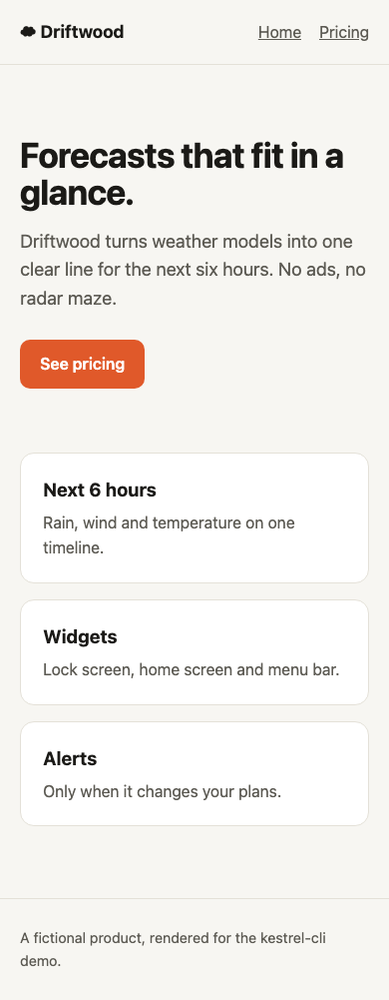
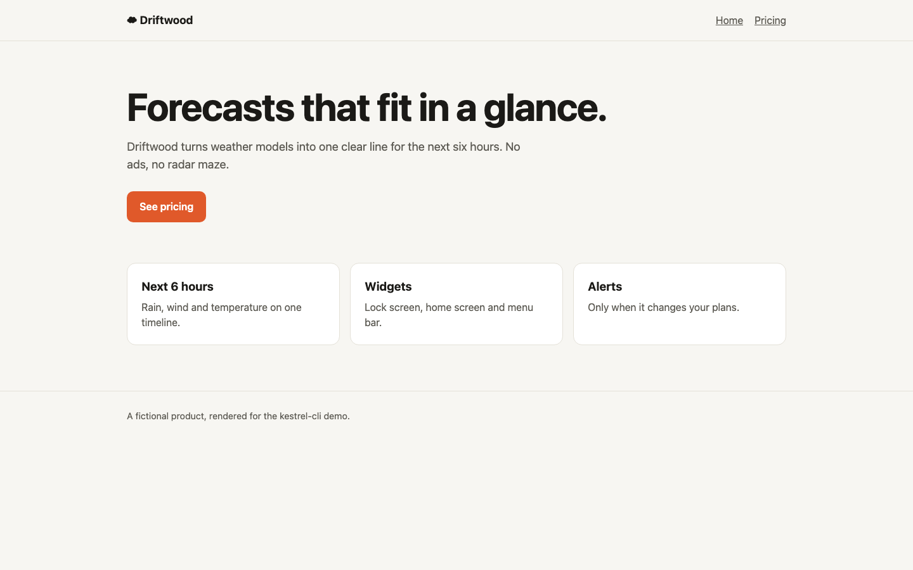
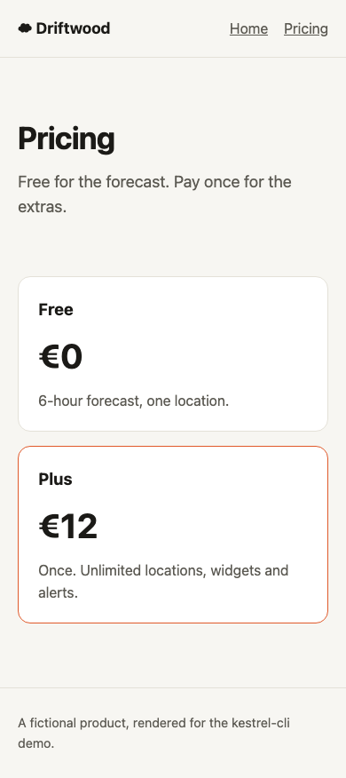
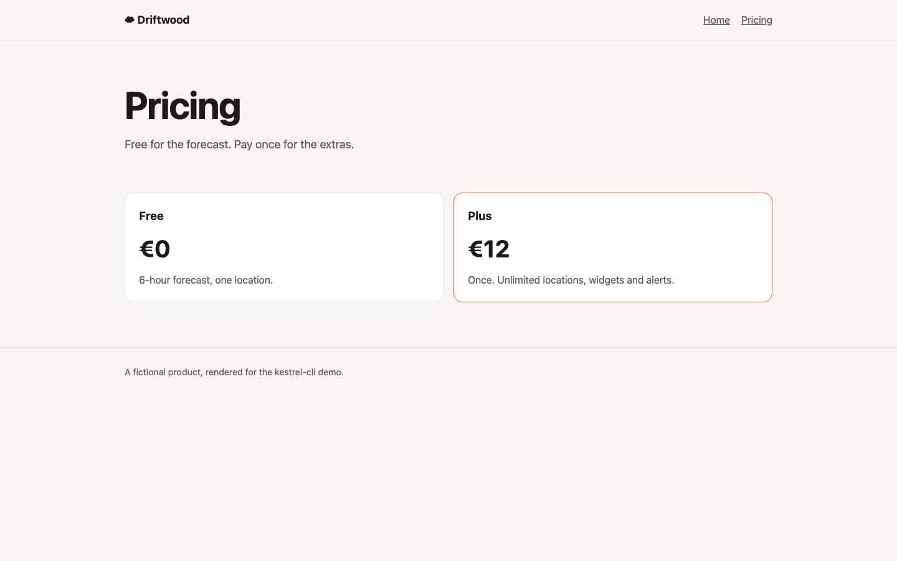
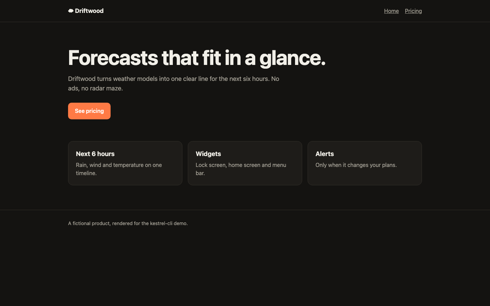
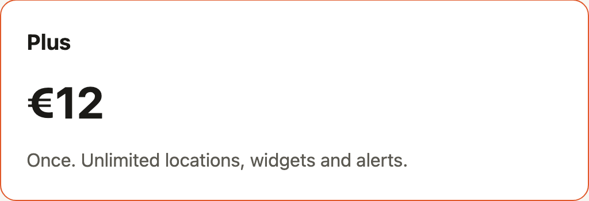

# kestrel-cli demo

[](https://github.com/Pixel-Process-UG/kestrel-cli-demo/actions/workflows/screenshots.yml)

A working example of [`kestrel shot`](https://github.com/Pixel-Process-UG/kestrel-cli): screenshots of a web page in CI, with no screen and no Mac. Every push runs [the workflow](.github/workflows/screenshots.yml) on Linux, macOS and Windows. It serves the small site in [`site/`](site), captures it with the Kestrel GitHub Action, uploads the images as artifacts and commits the Linux run's images to [`screenshots/`](screenshots). The images below are that output.

To try it on your own site, fork this repo and change the URLs, or open the latest [workflow run](https://github.com/Pixel-Process-UG/kestrel-cli-demo/actions/workflows/screenshots.yml) to download the images from every OS.

## Phone and desktop, full page

```yaml
- uses: Pixel-Process-UG/kestrel-cli@v0.1.0
  with:
    urls: http://localhost:8000/ http://localhost:8000/pricing.html
    args: --viewport 390x844 --viewport 1440x900 --full-page --wait-for "#app main" --hide .cookie-banner
    out: screenshots/light
```

The page renders its content with JavaScript after a delay, so `--wait-for` holds the capture until it is there. `--hide` removes the cookie banner.

<p>
  
  
</p>
<p>
  
  
</p>

## Dark mode

`--dark` emulates `prefers-color-scheme: dark`.



## One element at 2x

`--selector ".card.pick" --scale 2` captures only the first matching element, at Retina resolution.



## Locally

```bash
curl -fsSL https://github.com/Pixel-Process-UG/kestrel-cli/releases/latest/download/kestrel-linux-x64 -o kestrel  # or kestrel-macos, kestrel-windows-x64.exe
chmod +x kestrel
python3 -m http.server 8000 -d site &
./kestrel shot http://localhost:8000/ --viewport 390x844 --full-page --wait-for "#app main" --hide .cookie-banner -o screenshots
```

Needs Chrome or Chromium (or `CHROME=/path/to/chrome`). All options are in the [kestrel-cli README](https://github.com/Pixel-Process-UG/kestrel-cli#use).

Kestrel for macOS, the menu-bar screenshot app, is at [kestrelscreen.app](https://kestrelscreen.app).
